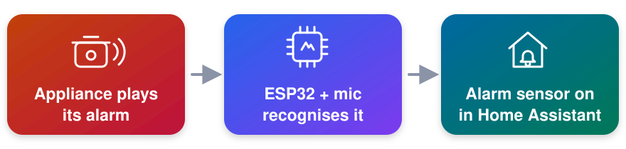

# ESPHome Alarm Sound Detector

An [ESPHome](https://esphome.io) external component that **listens for an
appliance's alarm sound and tells Home Assistant** — "the Thermomix is done",
"the rice cooker finished", and so on.

<p align="center"></p>

<p align="center">
<b><a href="#a-use-a-ready-made-preset-your-appliance-is-in-the-catalog">Use a ready-made preset</a></b> (Thermomix TM6) ·
<b><a href="#b-create-a-preset-for-your-appliance">Teach it another alarm</a></b> ·
<b><a href="#c-let-your-ai-agent-do-it">Give the job to your AI agent</a></b>
</p>

- **Local:** detection runs on the device; sound never leaves it.
- **Small:** ~10 KB per sound, a few % CPU, no PSRAM.
- **Most ESP32 hardware:** ESP32 / ESP32-S3 with an I²S, PDM or built-in microphone.
- **Easy to extend:** a browser [preset studio](https://gl0wa.github.io/esphome-alarm-sound-detector/)
  teaches it new sounds.

## How it works

The microphone signal (16 kHz) is turned into a spectrogram, normalised
against the room's background noise, and compared every 16 ms with a stored
"fingerprint" of the alarm sound (normalised cross-correlation). Each
match above a threshold counts as one *repetition*; for repeating alarms the
detector also checks the rhythm (the TM6 chime repeats every 3.125 s), which
makes random kitchen sounds very unlikely to trigger it. Details:
[`components/alarm_sound_detector/README.md`](components/alarm_sound_detector/README.md)
and the [TM6 measurements](docs/acoustic_analysis.md).

## Hardware

An **ESP32 or ESP32-S3** (ESP-IDF framework, ESPHome 2026.11.0+) with a
microphone ESPHome can run at **16 kHz mono**: an I²S MEMS module (INMP441,
ICS-43434, SPH0645, …), a PDM microphone, or a built-in one (M5Stack CoreS3,
Seeed XIAO ESP32S3 Sense, M5Stack Atom Echo, …). The studio and the `asd` tool
generate the configuration; for other microphones adapt it following ESPHome's
[I²S microphone](https://esphome.io/components/microphone/i2s_audio/) and
[audio ADC](https://esphome.io/components/audio_adc/) docs.

| Hardware | Status |
|---|---|
| M5Stack Stamp S3 + INMP441 | reference; in daily use with a real Thermomix TM6 |
| M5Stack CoreS3 SE (built-in mic) | recording and detection verified with a test sound from a speaker |
| other boards and microphones | expected to work, not yet verified — reports welcome |

The reference wiring (INMP441 to a Stamp S3, about €10) is **just an example** —
use pins suitable for your board. Microphones, wiring and placement:
[docs/wiring.md](docs/wiring.md).

## Getting started

<a href="https://gl0wa.github.io/esphome-alarm-sound-detector/"></a>

Paths A and B start in the **[preset studio](https://gl0wa.github.io/esphome-alarm-sound-detector/)**
(also on a phone — scan the code), which generates the complete ESPHome YAML
for your board and microphone.

<br clear="right">

### A. Use a ready-made preset (your appliance is in the catalog)

1. In the studio press **Browse presets**, tick your appliance and pick your
   board and microphone.
2. Copy the generated YAML into the ESPHome dashboard (**New device** → paste)
   and install it (first time over USB, then over Wi-Fi). Make sure your ESPHome
   `secrets.yaml` has `wifi_ssid` and `wifi_password`.
3. Add the discovered ESPHome device in Home Assistant, entering the API
   encryption key from the generated YAML if prompted. Then play the chime and
   watch the *Thermomix TM6 alarm* binary sensor turn on.

### B. Create a preset for your appliance

First record the alarm, in one of two ways:

- **With the device** (most accurate): install the generated *temporary*
  recording firmware, then record through it from your phone or computer — the
  ESP32's own microphone, placed where it will finally listen.
- **With a phone or laptop** (quickest): record in the studio or load audio files.

Then mark the alarm, let the studio find the other occurrences, build, test, and
install the generated normal firmware with your preset. Optionally share the
preset on GitHub.

Details: [docs/preset_authoring.md](docs/preset_authoring.md).

### C. Let your AI agent do it

Coding agents with a terminal (Claude Code, Codex, Gemini CLI, Cursor, GitHub
Copilot, …) can do A or B for you with the `asd` command-line tool and tell you
when to plug in the device or play the alarm. Give your agent this prompt:

> Set up an ESPHome alarm sound detector for my *appliance* and connect it to
> Home Assistant. Follow https://gl0wa.github.io/esphome-alarm-sound-detector/agent-guide.md
> — use its asd tool, keep my audio recordings on this computer, and ask me
> before flashing anything or whenever you need me to do something physical.

Agents find their instructions in [docs/agent_guide.md](docs/agent_guide.md)
(via [AGENTS.md](AGENTS.md) and friends).

### Writing the YAML by hand

Prefer to configure everything yourself? Start from
[`examples/stamp-s3-inmp441-thermomix-tm6.yaml`](examples/stamp-s3-inmp441-thermomix-tm6.yaml)
(I²S microphone module) or
[`examples/m5stack-cores3-thermomix-tm6.yaml`](examples/m5stack-cores3-thermomix-tm6.yaml)
(board with a built-in microphone).
The essential part:

```yaml
external_components:
  - source: github://gl0wa/esphome-alarm-sound-detector@main
    components: [alarm_sound_detector]

alarm_sound_detector:
  - id: tm6
    microphone:
      microphone: mic            # an i2s_audio microphone at 16 kHz
      bits_per_sample: 16
    template: vorwerk_thermomix_tm6_alarm   # a bundled preset, a JSON file, or an inline preset

binary_sensor:
  - platform: alarm_sound_detector
    alarm_sound_detector_id: tm6
    name: "Thermomix alarm"
```

Several detectors can share one microphone (one block per appliance).
All options: [component reference](components/alarm_sound_detector/README.md).

## Presets

| Preset | Appliance | Sound | Validation |
|---|---|---|---|
| `vorwerk_thermomix_tm6_alarm` (alias `thermomix_tm6`) | Vorwerk Thermomix TM6 | End-of-step / finished chime | One household, one volume setting |

The catalog is [`components/alarm_sound_detector/presets/`](components/alarm_sound_detector/presets/);
contributions welcome ([how](docs/preset_authoring.md)).

## Home Assistant

The component exposes an **alarm binary sensor** and a **match score sensor**
(handy for spotting near misses). A blueprint that notifies your phone only if
the alarm is *still ringing* after a configurable delay is included:
[docs/home_assistant.md](docs/home_assistant.md).

## Privacy and security

- The normal firmware sends Home Assistant only the alarm state and the match
  score, over the encrypted ESPHome API.
- The temporary **recording firmware** (`capture_server` component) streams
  audio over unencrypted HTTP to a browser (its recording page) or to
  `asd record`, only while that client is recording and only to clients
  holding the capture key (studio QR code / `device.json`). Browsers cannot
  encrypt traffic to a device without a trusted certificate, so use it on a
  trusted home network and install it only for a recording session. A
  "Sound capture active" sensor shows in Home Assistant whenever it streams.
- For developers there is also an encrypted (AES-256-GCM) capture path with a
  Python recorder: [docs/data_collection.md](docs/data_collection.md).
- Presets contain only an averaged spectral fingerprint, never recordings.

## Known limitations

- Each preset is validated in very few homes so far; the TM6 preset was tuned
  in one kitchen at one volume setting. Watch the match score in Home
  Assistant for the first days and report near misses or false alarms.
- **Latency:** the bundled TM6 preset waits for two matching chimes, typically
  6–8 s after the TM6 starts chiming (its first chime is often masked by the
  lid-release mechanism). Custom presets choose their own count; single-sound
  presets can trigger on one sound.
- Loud sound overlapping the alarm (running water, an extractor hood at full
  power, music) lowers the match score and can delay or prevent detection.
- Very short single beeps carry little information and are easier to confuse
  with other beeps than melodies or repeating patterns.
- ESP-IDF framework only; ESP32-C3/C6/H2 untested (see [Hardware](#hardware)).

## Development

- `components/alarm_sound_detector/` — the component (portable C++ core +
  ESPHome wrapper) and bundled presets.
- `components/capture_server/` — the temporary recording firmware's web
  recorder (page served by the device, hands clips to the studio).
- `components/audio_capture/`, `tools/capture/` — developer-only encrypted
  audio capture and Python recorder ([protocol](docs/capture_protocol.md)).
- `tools/detector/` — Python reference implementation (the specification),
  preset builder and evaluator.
- `web/` — the browser preset studio (the C++ core compiled to WebAssembly) and
  `web/cli/` — the same pipeline as a command-line tool for agents and scripts.
- `tests/` — C++/Python equivalence tests, preset validation; run `pytest`.
- `firmware/` — the reference device configuration used during development.

## License

[MIT](LICENSE) © 2026 Slawomir Wdowka
