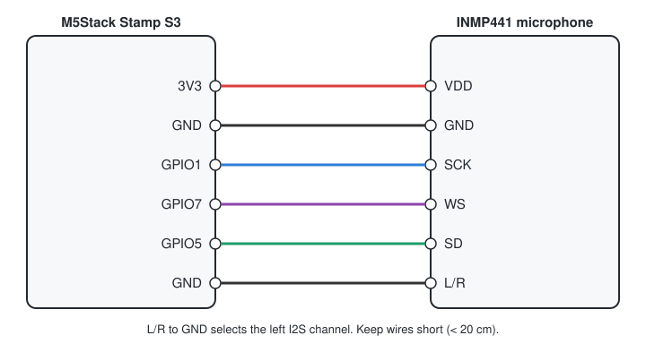

# ESPHome Alarm Sound Detector

An [ESPHome](https://esphome.io) external component that **listens for an
appliance's alarm sound and tells Home Assistant** — "the Thermomix is done",
"the rice cooker finished", and so on.

- **Local and private:** detection runs on the ESP32. The normal firmware never
  sends sound anywhere — Home Assistant only receives "alarm on/off".
- **Small:** a spectral template matcher (~10 KB per sound, a few % CPU on an
  ESP32-S3, no PSRAM needed).
- **Presets:** one line of YAML for supported appliances; a browser-based
  [preset studio](https://gl0wa.github.io/esphome-alarm-sound-detector/) to
  teach it new sounds.

First supported appliance: **Vorwerk Thermomix TM6** (end-of-step / cooking
finished chime).

## How it works

The microphone signal (16 kHz) is turned into a spectrogram, normalised
against the room's background noise, and compared every 16 ms with a stored
"fingerprint" of the alarm sound (normalised cross-correlation). Each
match above a threshold counts as one *repetition*; for repeating alarms the
detector also checks the rhythm (the TM6 chime repeats every 3.125 s), which
makes random kitchen sounds very unlikely to trigger it. Details:
[`components/alarm_sound_detector/README.md`](components/alarm_sound_detector/README.md)
and the [TM6 measurements](docs/acoustic_analysis.md).

## Hardware

An ESP32-S3 board and an INMP441 I2S microphone (about €10 together). Tested
with an M5Stack Stamp S3 — see [wiring and placement](docs/wiring.md).



## Getting started — pick your path

Both paths start in the **[preset studio](https://gl0wa.github.io/esphome-alarm-sound-detector/)**,
which generates the complete ESPHome YAML for you (defaults for the reference
hardware, your own pins if needed). Wire the microphone first: [docs/wiring.md](docs/wiring.md).

### A. Use a ready-made preset (your appliance is in the catalog)

1. In the studio choose **Use a ready-made preset**, pick your appliance.
2. Copy the generated YAML into the ESPHome dashboard (**New device** → paste)
   and install it (first time over USB, then over Wi-Fi). Make sure your ESPHome
   `secrets.yaml` has `wifi_ssid` and `wifi_password`.
3. Add the discovered device in Home Assistant.

That's all — this firmware never sends sound off the device.

### B. Create a preset for your appliance

1. In the studio choose **Create a preset for your appliance** and install the
   generated **recording firmware**. This is a *temporary* firmware: it is the
   only one that can send sound, and only to your own browser, only while you
   press Record.
2. Scan the QR code with your phone (it contains the device address and a
   private key, so there is nothing to type), record the alarm a few times plus
   some everyday background sounds, and tap **Send to the preset studio**.
3. Mark the alarm in the studio, let it find the other occurrences, build and
   test the preset.
4. Install the generated **normal firmware**, which now contains your preset —
   the device is back in private mode. Optionally share the preset on GitHub.

Details: [docs/preset_authoring.md](docs/preset_authoring.md).

### Writing the YAML by hand

Prefer to configure everything yourself? Start from
[`examples/stamp-s3-inmp441-thermomix-tm6.yaml`](examples/stamp-s3-inmp441-thermomix-tm6.yaml).
The essential part:

```yaml
external_components:
  - source: github://gl0wa/esphome-alarm-sound-detector@main
    components: [alarm_sound_detector]

alarm_sound_detector:
  - id: tm6
    microphone:
      microphone: mic            # an i2s_audio microphone at 16 kHz
      bits_per_sample: 16
    template: vorwerk_thermomix_tm6_alarm   # a bundled preset, a JSON file, or an inline preset

binary_sensor:
  - platform: alarm_sound_detector
    alarm_sound_detector_id: tm6
    name: "Thermomix alarm"
```

Several detectors can share one microphone (one block per appliance).
All options: [component reference](components/alarm_sound_detector/README.md).

## Presets

| Preset | Appliance | Sound | Validation |
|---|---|---|---|
| `vorwerk_thermomix_tm6_alarm` (alias `thermomix_tm6`) | Vorwerk Thermomix TM6 | End-of-step / finished chime | One household, one volume setting |

The catalog is [`components/alarm_sound_detector/presets/`](components/alarm_sound_detector/presets/).

<a href="https://gl0wa.github.io/esphome-alarm-sound-detector/"></a>

**Your appliance is not listed?** Record it and build a preset in the
**[preset studio](https://gl0wa.github.io/esphome-alarm-sound-detector/)** —
everything runs in your browser, also on a phone (scan the QR code to open it
next to the appliance). Then use the exported file directly or contribute it:
[docs/preset_authoring.md](docs/preset_authoring.md).

<br clear="right">

## Home Assistant

The component exposes an **alarm binary sensor** and a **match score sensor**
(handy for spotting near misses). A blueprint that notifies your phone only if
the alarm is *still ringing* after a configurable delay is included:
[docs/home_assistant.md](docs/home_assistant.md).

## Privacy and security

- The normal firmware never transmits audio; only entity states go to Home
  Assistant over the encrypted ESPHome API.
- The temporary **recording firmware** (`capture_server` component) sends audio
  only while you press Record in its page, only to a browser holding the
  capture key from the studio's QR code, and only within your home network.
  Browsers cannot encrypt traffic to a device without a trusted certificate,
  so this audio crosses your Wi-Fi unencrypted — which is why the recording
  firmware is meant to be installed only for a recording session. A
  "Sound capture active" sensor shows in Home Assistant whenever it streams.
- For developers there is also an encrypted (AES-256-GCM) capture path with a
  Python recorder: [docs/data_collection.md](docs/data_collection.md).
- Presets contain only an averaged spectral fingerprint, never recordings.

## Known limitations

- Each preset is validated in very few homes so far; the TM6 preset was tuned
  in one kitchen at one volume setting. Watch the match score in Home
  Assistant for the first days and report near misses or false alarms.
- **Latency:** an alarm is reported after two matching repetitions — about
  6–8 s after the TM6 starts chiming (its first chime is often masked by the
  lid-release mechanism).
- Loud sound overlapping the alarm (running water, an extractor hood at full
  power, music) lowers the match score and can delay or prevent detection.
- Very short single beeps carry little information and are easier to confuse
  with other beeps than melodies or repeating patterns.
- Tested on ESP32-S3 with the ESP-IDF framework only.

## Development

- `components/alarm_sound_detector/` — the component (portable C++ core +
  ESPHome wrapper) and bundled presets.
- `components/capture_server/` — the temporary recording firmware's web
  recorder (page served by the device, hands clips to the studio).
- `components/audio_capture/`, `tools/capture/` — developer-only encrypted
  audio capture and Python recorder ([protocol](docs/capture_protocol.md)).
- `tools/detector/` — Python reference implementation (the specification),
  preset builder and evaluator.
- `web/` — the browser preset studio (the C++ core compiled to WebAssembly).
- `tests/` — C++/Python equivalence tests, preset validation; run `pytest`.
- `firmware/` — the reference device configuration used during development.

## License

[MIT](LICENSE) © 2026 Slawomir Wdowka
