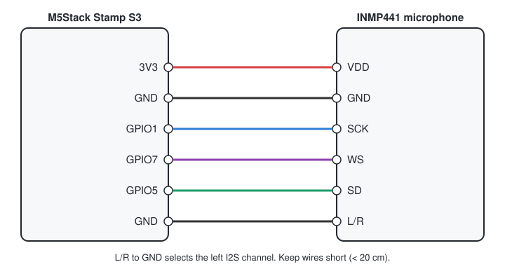

# Hardware and wiring

## Tested hardware

| Part | Notes |
|---|---|
| M5Stack Stamp S3 (ESP32-S3, 8 MB flash, no PSRAM) | Any ESP32-S3 board should work; the detector needs no PSRAM. |
| INMP441 I2S MEMS microphone breakout | 3.3 V, 24-bit I2S, flat response ~60 Hz–15 kHz. |
| 5 V USB-C power supply | The device is meant to be mains powered (Wi-Fi power saving off). |

Other ESP32 variants with I2S (ESP32, ESP32-S3) are expected to work with the
ESP-IDF framework but have not been tested yet.

## Wiring

| INMP441 | Stamp S3 |
|---|---|
| VDD | 3V3 |
| GND | GND |
| SCK | GPIO1 |
| WS | GPIO7 |
| SD | GPIO5 |
| L/R | GND (left channel) |

Any free GPIOs can be used; set them in the `substitutions` of the example
configuration. If you tie L/R to 3V3 instead, use `channel: right`.

## Placement

- Put the microphone opening within 1–2 m of the appliance's speaker with a
  clear line of sight; avoid placing it directly next to an extractor hood,
  sink or kettle.
- Keep it away from heat and steam (the INMP441 and the ESP32 are not
  splash-proof). A small 3D-printed or project-box enclosure with an opening
  for the microphone port works well.
- One device can listen for several appliances if it hears all of them
  clearly; appliances in other rooms need their own device.
